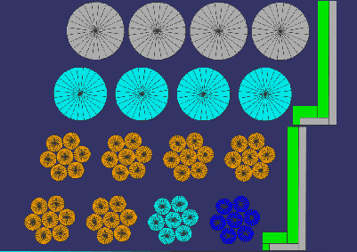
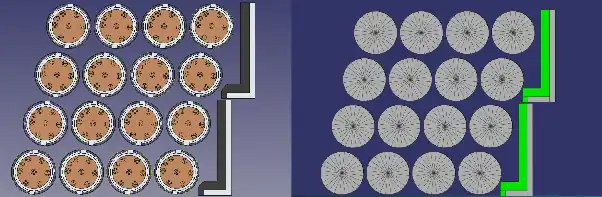
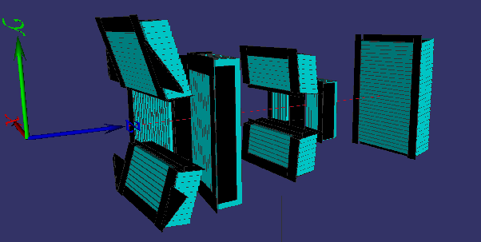
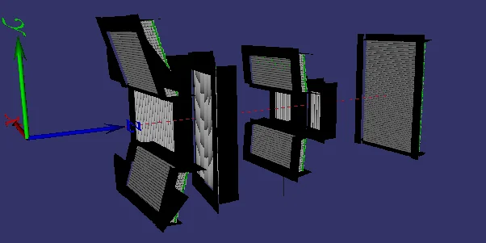
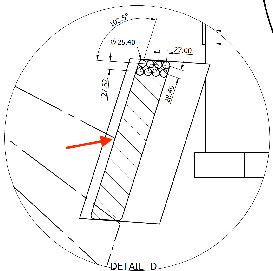
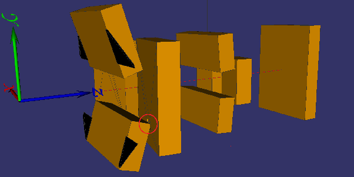
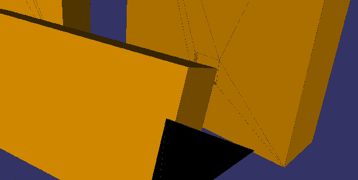
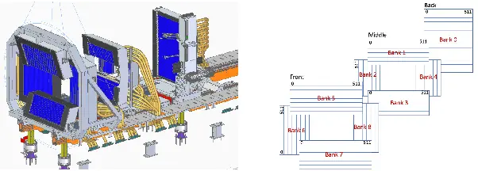
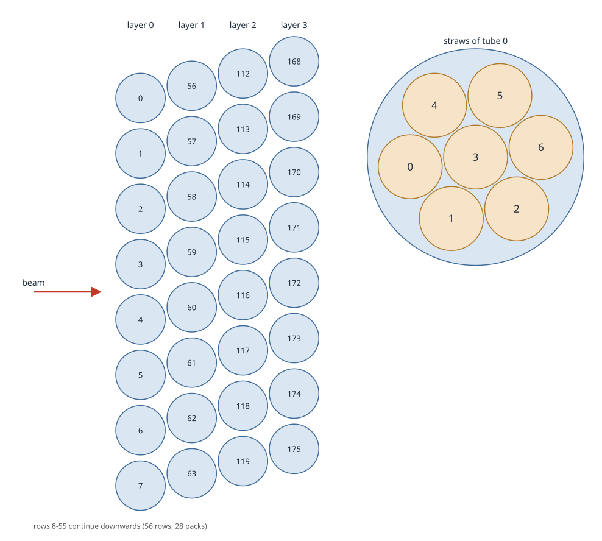
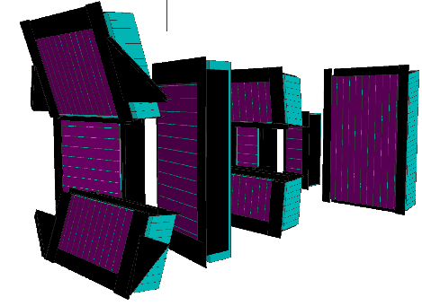

Detector geometry
=================

The Geant4 model of the LoKI detectors is the geometry module ``GeoBCSBanks`` of the :sbpkg:`G4GeoLoki` package
(:sbpkg:`G4GeoLoki/pymod__GeoBCSBanks/geometry_module.cc`). All simulation commands of LOKI and LokiMasking use it.

The model
---------

The detector system has 9 banks: the rear bank (0, movable along the beam), 4 middle banks (1-4) and 4 front banks
(5-8). A bank holds packs of 8 BCS tubes (4 layers of 2 tubes), each tube holding 7 copper straws. The model is built
from these blocks: a tube, a pack of 8 tubes with the B4C absorber panel behind them, and a bank of packs with its
boron masks.

   Two BCS packs; aluminium in grey, Ar/CO2 gas in turquoise, copper in orange, B4C converter in blue, B4C absorber in green

.. list-table::
   :header-rows: 1

   * - Part
     - Model
   * - Tube
     - Aluminium (NCrystal ``Al_sg225.ncmat``), outer diameter 25.4 mm (1"), wall 0.889 mm
   * - Straw
     - Copper (NCrystal ``Cu_sg225.ncmat``), outer diameter 7.5 mm, wall 0.0254 mm
   * - Converter
     - B4C, 95 % ¹⁰B, on the inner surface of the straws: 0.65 µm in the front two layers, 1 µm in the back two
   * - Gas
     - Ar/CO2 80/20 (by volume) at 0.7 atm, in the tubes and the straws
   * - Absorber panel
     - B4C behind each pack (geometry parameter ``B4C_panel_material``, default ``MAT_B4C:b10_enrichment=0.95``) on an aluminium plate
   * - Boron masks
     - B4C sheets on the banks (covering the frames, which are not modelled)

The packs, absorber panels and masks are placed as in the CAD model and its technical drawings (the rounded corner of
the absorber panel is not modelled; the panel material has no epoxy or inhomogeneity).

   Two packs in the CAD model (left) and in Geant4 (right)

The straws are not divided into pixels in the geometry: the gas in a straw is one volume, and the analysis finds the
pixel from the position of the detection along the straw. The number of pixels per straw is therefore a parameter of
the analysis, not of the simulation.

   The full detector system: packs (turquoise) and boron masks (black)

   Only the physical components (the curved lines over the vertical tubes are rendering artifacts)

The code
--------

The parameters of the geometry are in classes of ``G4GeoLoki/libinc`` and ``G4GeoLoki/libsrc``, used by the geometry
module and also by the aiming, the analysis and the tools, so that each value is defined once:

.. list-table::
   :header-rows: 1

   * - Class
     - Contents
   * - ``BcsTube``
     - A tube and its straws: dimensions, materials, converter thicknesses.
   * - ``BcsPack``
     - A pack of 8 tubes with the absorber panel.
   * - ``BcsBanks``
     - The 9 banks: dimensions, packs, tube numbering, masks, beamstops, the placement of the banks in the world (``getBankTransform``) and the notch of banks 6 and 8.
   * - ``BankCalibration``
     - Named bank calibrations: measured placements of the banks (see :ref:`loki-geometry-bank-calibrations`).
   * - ``BoronMasks``
     - The boron masks of the banks.
   * - ``CalibMasks``
     - The calibration slit masks (optional).
   * - ``PixelatedBanks``
     - ``BcsBanks`` with pixels along the straws: pixel ids from hit positions (used by the analysis).
   * - ``AimHelper``
     - ``PixelatedBanks`` with the pixel centre positions (used for aiming, the tools and the tests); Python module ``G4GeoLoki.LokiAimHelper``.

Bank placement
--------------

Each bank is a box (a virtual volume holding its packs and masks) placed in the world, whose origin is the nominal
sample position: x horizontal (positive to the left, looking along the beam), y up, z along the beam. Inside a bank
(the *bank frame*), x is the depth (from the front, facing the sample), y is across the tubes and z is along the tubes.

The placement of a bank is defined by the centre F of its front face (the plane touching the front layer of tubes, in
the middle of the front layer and of the straw length) and three unit vectors: u along the tubes, w across the tubes
in the tube plane, and n = u × w, the layer normal pointing away from the sample. ``BcsBanks::getBankTransform`` turns
them into the rotation and translation of the bank box; the geometry, the aiming and the pixel ids all use this one
function. The nominal values of F, u, w and n come from the tables of ``BcsBanks`` (distances and angles of the
technical drawings), or from a bank calibration.

   A section of a bank in a technical drawing: the red arrow marks the reference point of the drawing's distances and
   angles (the centre-most front point of the first tube layer), from which the nominal F, u, w and n are computed

The rear bank moves along the beam: its distance from the sample is the geometry parameter
``rear_detector_distance_m`` (4-10 m, default 5 m), the distance of its front face.

.. _loki-geometry-bank-calibrations:

Bank calibrations
~~~~~~~~~~~~~~~~~

The geometry parameter ``bank_calibration`` selects the placement of the banks:

.. list-table::
   :header-rows: 1

   * - Value
     - Placement
   * - ``2026-September-SAM-606`` (default)
     - The survey of September 2026: banks 1-8 measured; the rear bank (not surveyed) from the CAD geometry.
   * - ``nominal-cad-geometry``
     - The intended CAD geometry.
   * - ``nominal-geant4-geometry``
     - The built-in tables of ``BcsBanks`` (the geometry before the calibrations).
   * - a path (any value containing a ``/``), e.g. ``./mycal.txt``
     - A calibration file (without a ``/`` the value is taken as a name).

A name selects the file ``G4GeoLoki/data/bank_calibration_<name>.txt``. The file gives F, u, w and n of each calibrated
bank (in mm, in the world frame); banks without a line keep their nominal placement. For the rear bank only the
direction and the x and y of F are used: its z is set by ``rear_detector_distance_m``. The format is described in
:sbpkg:`G4GeoLoki/libinc/BankCalibration.hh`.

The calibration files are written by `loki-geometry <https://github.com/MilanKlausz/loki-geometry>`__, which computes the
bank placements from a survey (see :ref:`loki-geometry-adding-a-calibration`). Examples:

.. code:: sh

   sb_loki_sim bank_calibration=nominal-geant4-geometry --view   # the nominal placement
   sb_loki_info -c nominal-cad-geometry -p 0                       # a pixel of the CAD geometry

The simulation records the calibration (its name and the text of its file) in the GRIFF file, and the analysis uses
the recorded placement, so a changed or deleted calibration file does not change the analysis of an existing GRIFF
file. GRIFF files from before the calibrations (without the ``bank_calibration`` parameter) are analysed with the
nominal Geant4 geometry.

.. _loki-geometry-adding-a-calibration:

Adding a calibration
~~~~~~~~~~~~~~~~~~~~

1. Make the calibration file with loki-geometry (its "A new survey" and "Bank calibration for the Geant4 geometry"
   sections): ``loki-calibrate --survey-file NEW.txt --geant4-calibration-file <dgcode_projects>/LOKI/G4GeoLoki/data/``
   writes ``bank_calibration_<name>.txt`` there.
2. Rebuild (``sb``): only then is the new file found by its name (``bank_calibration=<name>``).
3. Check the geometry: ``sb_loki_sim bank_calibration=<name> --test``, and add the name to the configurations of
   :sbpkg:`G4GeoLokiTests/scripts/test_geo_dense_overlaps` (the dense overlap test, see :doc:`testing`).
4. Verify the pixel geometry of loki-geometry for it: ``loki-pixel-json -c <name> ...`` and
   ``sb_g4geoloki_verifyjson`` (see :ref:`loki-geometry-verification`).
5. Add it to the table above, and commit the data file (and the test) to dgcode_projects.

To make it the default, change ``defaultName`` in :sbpkg:`G4GeoLoki/libsrc/BankCalibration.cc`; the tests that pin the
default (``test_pixel_position_default`` and the calibrated sections of the tests) then need new reference logs.

Bank volumes and the notch
~~~~~~~~~~~~~~~~~~~~~~~~~~

   The bank volumes (the front banks on the left of the picture, the rear bank on the right): bank 5 (front top)
   overlaps with bank 8 (front right) in the red circle

The bank boxes of the front banks overlap: bank 5 (top) with bank 8 (right), and bank 7 (bottom) with bank 6 (left).
The overlap region is empty, so it is cut out of banks 6 and 8 (a *notch*, ``G4SubtractionSolid``). The notch is
computed from the bank placements in use: the nominal notch is kept if the overlap fits in it; otherwise it is
enlarged (the geometry prints ``notch enlarged``), and if it would cut into the packs the construction stops with an
error. The triangular boron masks of banks 5 and 7 are outside the bank boxes and placed with the transform of their
bank.

   The notch cut out of a bank volume

.. _loki-geometry-numbering-and-pixel-ids:

Numbering and pixel ids
-----------------------

The copy numbers of the Geant4 volumes (the index Geant4 gives each placed volume) follow the numbering of the ICD:
in the analysis, the copy numbers give the bank, tube and straw of a hit. Each straw is divided into N pixels along
its length (N is a parameter of the analysis, default 256).

   Numbering of the banks and of the pixels along the straws (from the ICD, drawn with 512 pixels per straw)

Tubes are numbered layer by layer from the front, along the tube rows in each layer: tube = layer × rows + row (a
pack adds two rows). The straws of a tube are numbered 0-6 (straw 3 on the tube axis), and the pixels along a straw
0 to N−1. Looking along the beam, the same in all banks:

.. list-table::
   :header-rows: 1

   * - 
     - Horizontal tubes (banks 0, 1, 3, 5, 7)
     - Vertical tubes (banks 2, 4, 6, 8)
   * - Tube 0
     - the top row of the front layer
     - the leftmost column of the front layer
   * - Pixel 0
     - the left end of the straw (+x)
     - the bottom end of the straw (−y)

(The packs of banks 1, 2, 5 and 6 are mounted upside down; their tube and pixel numbering is reversed in the code so
that the table holds for them too.)

   Tube and straw numbering of the top of the rear bank, viewed from the right-hand side (looking along the beam;
   the beam comes from the left), drawn from the Geant4 geometry by `LOKI/doc/figures/make_numbering_figure.py`.

The pixel id is

.. math::

   \text{pixel id} = \text{offset}_\text{bank} + (7 \cdot \text{tube} + \text{straw}) \cdot N + \text{pixel}

where offset\ :sub:`bank` is the number of pixels in the banks with a lower id (``sb_loki_info -d`` lists them). The
Geant4 pixel ids start at 0; the detector numbers of the ICD and of the NeXus files start at 1 (detector number =
pixel id + 1). The Geant4 pixel ids (e.g. in the detection file) already include offset\ :sub:`bank`; the +1 is
added when the mask files and the NeXus files are written.

.. list-table::
   :header-rows: 1

   * - Bank
     - 0
     - 1
     - 2
     - 3
     - 4
     - 5
     - 6
     - 7
     - 8
   * - Packs
     - 28
     - 8
     - 6
     - 8
     - 6
     - 14
     - 16
     - 10
     - 16
   * - Tubes
     - 224
     - 64
     - 48
     - 64
     - 48
     - 112
     - 128
     - 80
     - 128
   * - Straw length [mm]
     - 1000
     - 1000
     - 500
     - 1000
     - 500
     - 1200
     - 1200
     - 1200
     - 1200

In total: 112 packs, 896 tubes, 6272 straws, and 1 605 632 pixels with 256 pixels per straw.

Calibration slits
-----------------

With ``with_calibration_slits=true``, a calibration slit mask is placed in front of each bank: B4C with slits, to find
the pixels illuminated from the sample through the slits (see :ref:`masking <loki-simulation-masking-simulation>`). The masks
are defined in :sbpkg:`G4GeoLoki/libsrc/CalibMasks.cc` by a name, thickness, height, the distance from the left end of
the tubes, the elevation from the tube front, and the pattern of material and slit widths from left to right (in mm):

.. code:: cpp

   const CalibMasks::CalibMasksBase mask0("lokiStandard-0", 0.3, 1600.0, -47.0, 7.6,
     {94.,6., 94.,6., 94.,6., 94.,6., 94.,6., 94.,6., 94.,6., 94.,6., 94.,6., 94.,6., 94.});

This mask has 6 mm wide slits every 100 mm, and is centred vertically on the bank. The geometry uses the mask named
``lokiStandard-<bank id>`` for each bank; to change a mask, edit its definition, or add a new mask and select it for its
bank in the geometry module. The thickness and the material do not matter for the masking (geantinos do not
interact; the analysis treats the mask as absorbing). The masks are mounted inside the bank boxes: their elevation from
the tube front (the fifth value, 7.6 mm planned) can be 0.05 mm to about 23 mm.

   Calibration slits (the CalibMaskBox volume expanded)

.. _loki-geometry-beamstops:

Beamstops
---------

``beamstop_id`` (1-5, default 0: none) adds one of the beamstops of ESS-1178830, centred on the beam, 5 cm in front of
the rear bank:

.. list-table::
   :header-rows: 1

   * - Id
     - Width [mm]
     - Height [mm]
   * - 1
     - 30
     - 35
   * - 2
     - 20
     - 25
   * - 3
     - 50
     - 60
   * - 4
     - 65
     - 75
   * - 5
     - 100
     - 105

``sb_loki_info -d`` lists them as well.

Geometry parameters
-------------------

.. list-table::
   :header-rows: 1

   * - Parameter
     - Default
     - Meaning
   * - ``rear_detector_distance_m``
     - 5
     - Sample to rear bank front face distance (4-10 m).
   * - ``bank_calibration``
     - ``2026-September-SAM-606``
     - Bank placements, see :ref:`loki-geometry-bank-calibrations`.
   * - ``beamstop_id``
     - 0
     - Beamstop (0: none, 1-5).
   * - ``with_calibration_slits``
     - no
     - Calibration slit masks on all banks.
   * - ``B4C_panel_material``
     - ``MAT_B4C:b10_enrichment=0.95``
     - Material of the absorber panels behind the tubes.
   * - ``world_material``
     - ``G4_Vacuum``
     - Material of the world.

``sb_loki_sim -g`` lists the geometry parameters with their values; any parameter can be set on the command line, e.g.
``sb_loki_sim rear_detector_distance_m=10 beamstop_id=3 --view``.

.. _loki-geometry-visualisation:

Visualisation
-------------

Every simulation command can show the geometry and the simulated particles in the dgcode viewer (see the
`dgcode documentation <https://mctools.github.io/simplebuild-dgcode/vis.html>`__; it needs OpenSceneGraph):

.. list-table::
   :header-rows: 1

   * - Option
     - Shows
   * - ``--viewer`` (``--view``)
     - The geometry.
   * - ``--dataviewer`` (``--data``)
     - The geometry and the full tracks of the simulated particles.
   * - ``--aimdataviewer`` (``--aim``)
     - Like ``--dataviewer``, but only the first segment of the primary tracks (up to the first volume boundary).

The geometry and generator parameters can be added as for a simulation, so every setting can be checked visually.
Ctrl+H in the viewer shows the controls; middle-click (or left-click + x) on a volume opens it to show its content
(bank, pack, tube, straw).

.. tip::

   To see where particles aimed at the banks arrive, use ``--dataviewer``, not ``--aimdataviewer``: the bank boxes overlap
   and enclose each other's surroundings, so the first segment of a track usually ends at a bank box (except for the
   front banks). With ``--dataviewer``, ``primary_only=True`` hides the secondary particles, and ``geantino=1`` (flood
   source) keeps the tracks going through absorbers.

.. code:: sh

   sb_loki_sim --view
   sb_loki_sim rear_detector_distance_m=10 with_calibration_slits=true --view
   sb_loki_sim event_gen=flood aiming_bank_id=3 primary_only=True --data -n1000
   sb_lokimasking_sim aiming_bank_id=0 aiming_pixel_id_min=0 aiming_straw_pixel_number=256 -n256 --data

.. _loki-geometry-verification:

Verification
------------

**Overlaps.** Volumes must not overlap (with each other or with their mother volume); an overlap makes the tracks
wrong. Building the geometry (e.g. for ``--view``) runs a short overlap check, and ``-t`` (``--test``) a thorough one;
problems are reported as ``G4Exception`` (no output from the ``grep`` means no overlap):

.. code:: sh

   sb_loki_sim --test | grep "G4Exception" --context=4
   sb_loki_sim with_calibration_slits=1 bank_calibration=nominal-cad-geometry --test | grep "G4Exception" --context=4

The tests (``sb -t``, see :doc:`testing`) check all configurations, also with dense random sampling.

**Pixel positions.** ``sb_g4geoloki_writepixelfile`` writes the pixel centres of the geometry (columns: detector number
= pixel id + 1, as in the ICD and the NeXus files; x, y, z in m in the world frame, z from the sample unless ``-ssd``
is given):

.. code:: sh

   sb_g4geoloki_writepixelfile -f pixels -n 256                     # pixels.txt, default calibration
   sb_g4geoloki_writepixelfile -n 2 --bankId 3 --print              # bank 3, to the terminal
   sb_g4geoloki_writepixelfile -f nominal --bankCalibration nominal-geant4-geometry

The pixel centres come from ``AimHelper`` and use the same bank placement (``getBankTransform``) as the geometry; the
tests check them against Geant4 tracking (geantinos aimed at the pixel centres must reach their pixel).

**NeXus-JSON geometry.** ``sb_g4geoloki_verifyjson`` compares the pixel positions of a NeXus-JSON file (the instrument
file, e.g. ``loki.json``, or the output of `loki-geometry <https://github.com/MilanKlausz/loki-geometry>`__'s
``loki-pixel-json``) with the Geant4 pixel centres. It finds the banks by name (``/entry/instrument/loki_detector_<id>``),
follows their ``depends_on`` chains, and compares with the calibration recorded in the file (otherwise the nominal
Geant4 geometry, or ``--bankCalibration``). It compares the pixel offsets plus the bank position (not the pixel
shape: use it with files whose offsets are the pixel centres, the default of ``loki-pixel-json``; loki-geometry's
``loki-verify-json`` also checks the pixel shape). It exits with 1 if a bank differs by more than the tolerance (``-t``,
in m, default 0.0001 m = 0.1 mm; ``loki-verify-json --tolerance`` is in mm, default 1 mm):

.. code:: sh

   loki-pixel-json -o loki_detector_pixels.json --pixels-per-straw 16    # loki-geometry
   sb_g4geoloki_verifyjson --json loki_detector_pixels.json -rear 4.9998
   sb_g4geoloki_verifyjson --json loki.json -rear 4.9998 --bankCalibration nominal-cad-geometry

``-rear`` must be the distance of the rear bank front face in the file's geometry: 4.9998 m when its rear bank comes
from the CAD geometry (``nominal-cad-geometry``, and ``2026-September-SAM-606``, whose rear bank was not surveyed), the
default 5 m for ``nominal-geant4-geometry`` (``loki-info -b 0 -c NAME`` shows it).

**Geometry information.** ``sb_loki_info`` prints the numbers of packs, tubes, straws and pixels per bank (``-d``), or
the bank, pack, tube, straw and position of a pixel (``-p``; "InStraw id" is the pixel along the straw); ``-s`` sets the
pixels per straw, ``-c`` the calibration, ``-r`` the rear bank distance [m], ``--unit`` and ``--precision`` the printed
positions:

.. code:: console

   $ sb_loki_info -p 1214233 -s 512
   Used parameters: straw_pixel_number=512 rear_detector_distance_m=5.0 nominal_source_sample_distance_meters=23.6 bank_calibration=2026-September-SAM-606

   Pixel number: 1214233 (according to the Geant4 geometry. It corresponds to the pixelID 1214234 in the ICD.)
   Pixel centre position [m] X: -0.0512 Y: -0.3364 Z: 26.5403
   Bank id: 3
   Pack id: 1
   Tube id: 2
   Straw id: 5
   InStraw id: 281

The z of the positions includes the source to sample distance (``--nominal_source_sample_distance_meters``, default
23.6 m); set it to 0 for positions relative to the sample (as ``sb_g4geoloki_writepixelfile`` and loki-geometry give
them).

The same information from the Geant4 tools and from loki-geometry (which works in mm, from the sample):

.. list-table::
   :header-rows: 1

   * - 
     - dgcode (``sb_loki_info``)
     - loki-geometry (``loki-info``)
   * - A pixel by its pixel id
     - ``-p ID``
     - ``-p ID`` (``-d NUMBER``: by its detector number)
   * - Pixels per straw
     - ``-s N``
     - ``-n N``
   * - Rear bank distance
     - ``-r 5`` (m)
     - ``-r 5000`` (mm)
   * - Calibration
     - ``-c NAME``
     - ``-c NAME``
   * - Summary of the banks
     - ``-d``
     - (no option)
   * - Positions
     - m, z from the source (``--unit mm --nominal_source_sample_distance_meters 0`` for mm from the sample)
     - mm from the sample (``--unit m``)
