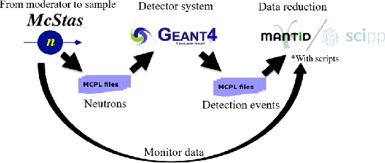

LOKI
====

Geant4 simulation of the boron-coated straw (BCS) detectors of
`LoKI <https://ess.eu/instruments/loki>`__, the small-angle neutron scattering instrument of the
European Spallation Source (ESS): the detector geometry, the simulation and analysis of neutron detection, masking
of the pixels that are not directly visible from the sample, and the processing of the results with Mantid. It also
contains the models of the detector tests at the Larmor instrument (ISIS) in 2020 and 2022.

New here? Install (including the shell setup), then follow :ref:`loki-simulation-a-first-simulation`. Terms are explained
in the :ref:`glossary <loki-index-glossary>` at the end of this page.

.. toctree::
   :maxdepth: 1

   installation
   geometry
   simulation
   analysis
   mcstas
   dmsc
   mantid
   larmor
   testing
   plotting

Packages
--------

.. list-table::
   :header-rows: 1

   * - Package
     - Contents
   * - :sbpkg:`G4GeoLoki`
     - The detector geometry (``GeoBCSBanks``), the geometry classes (banks, packs, tubes, masks, pixels), bank calibrations, ``AimHelper`` (pixel positions), pixel file export and JSON verification.
   * - :sbpkg:`LOKI`
     - Neutron simulation (``sb_loki_sim``) with the McStas (MCPL), flood source and other generators, the analysis (``sb_loki_ana``), the geometry info tool (``sb_loki_info``), plotting, DMSC submission templates.
   * - :sbpkg:`LokiMasking`
     - Masking simulation with geantinos (``sb_lokimasking_sim``), the analysis writing Mantid mask files (``sb_lokimasking_ana``), merging of mask files.
   * - :sbpkg:`LokiMantid`
     - Conversion of detection events to Mantid NeXus files (``sb_lokimantid_loki``); built only if ``mantidpython`` is available.
   * - :sbpkg:`G4GeoLokiTests`
     - Tests of the geometry, the pixel ids, the aiming, the masking chain and the bank calibrations.
   * - :sbpkg:`Larmor`, :sbpkg:`LarmorTests`, :sbpkg:`LarmorMantid`
     - The Larmor 2020 and 2022 detector tests (in ``LOKI/Larmor/``), see :doc:`larmor`.

Related, in its own repository: `loki-geometry <https://github.com/MilanKlausz/loki-geometry>`__ (Python) computes the
surveyed bank placements (the bank calibration files of G4GeoLoki) and the pixel geometry of the instrument's NeXus
file, see :ref:`loki-installation-loki-geometry-optional`.

Workflows
---------

   The simulation and data workflow

The full workflow starts with a McStas simulation of the instrument from the moderator to the sample. The neutrons
scattered by the sample are saved in an MCPL file, which is the source of the Geant4 simulation of the detectors. The
Geant4 simulation writes a GRIFF file; its analysis writes the detection events (pixel id and time of flight) to an
MCPL file, which a Mantid script converts to NeXus files, together with the monitor spectra of the McStas simulation.

.. list-table::
   :header-rows: 1

   * - Workflow
     - Source of the neutrons
     - Steps
     - Result
   * - McStas + Geant4
     - MCPL file of a McStas simulation
     - :doc:`McStas <mcstas>` → ``sb_loki_sim event_gen=mcpl`` → ``sb_loki_ana`` → ``sb_lokimantid_loki``
     - NeXus files (detectors, monitors)
   * - Flood source
     - ``FloodSourceGen``: uniform scattering from the sample, no McStas
     - ``sb_loki_sim event_gen=flood`` → ``sb_loki_ana`` → ``sb_lokimantid_loki``
     - NeXus files (detectors, a calculated pre-sample monitor)
   * - Masking
     - ``MaskingSourceGen``: one geantino per pixel centre
     - ``sb_lokimasking_sim`` → ``sb_lokimasking_ana``
     - Mantid mask files (one per bank)

For results to be processed with Mantid, simulate with ``bank_calibration=nominal-geant4-geometry`` (see
:doc:`mantid`).

.. _loki-index-glossary:

Glossary
--------

BCS
   Boron-coated straws: the detector type (tubes with 7 copper straws coated with a ¹⁰B4C converter).
Bank calibration
   The measured placement of the detector banks (from a survey), selected with ``bank_calibration``; see
   :ref:`loki-geometry-bank-calibrations`. Not to be confused with the calibration *slits* (masks for position calibration).
Copy number
   The index Geant4 gives a placed volume; here the bank, tube and straw numbers (see :ref:`loki-geometry-numbering-and-pixel-ids`).
Detector number
   Pixel id + 1: the 1-based pixel number of the ICD, the NeXus files and the mask files.
DMSC
   Data Management and Software Centre (its computing cluster).
Geantino
   A Geant4 test particle that travels in a straight line without interacting (used for the masking).
GRIFF
   Geant4 Results In Friendly Format: the output of the dgcode simulations, read by the analysis programs. ``REDUCED``
   is the storage mode used here (see the dgcode documentation).
ICD
   Interface Control Document of the LoKI detectors (the numbering of banks, tubes, straws and pixels).
IDF
   Instrument Definition File (Mantid).
Launcher
   The Python module that sets up a simulation (generator, output, parameters): ``Launcher.py`` of a package.
MCPL
   Monte Carlo Particle List: the particle file format between McStas and Geant4, also used for the detection events.
Notch
   The empty corner cut out of the volumes of banks 6 and 8 where the volumes of banks 5 and 7 overlap them.
Pixel id
   The 0-based pixel number of the Geant4 geometry and the analysis (see :ref:`loki-geometry-numbering-and-pixel-ids`).
SAM-606
   The identifier of the survey of the detector banks in September 2026, the source of the default bank calibration
   ``2026-September-SAM-606``.
SimpleHists
   dgcode's histogram file format (``.shist``).
TOF
   Time of flight.
